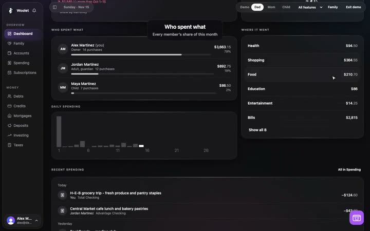
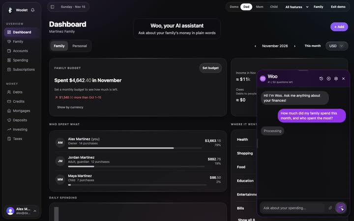
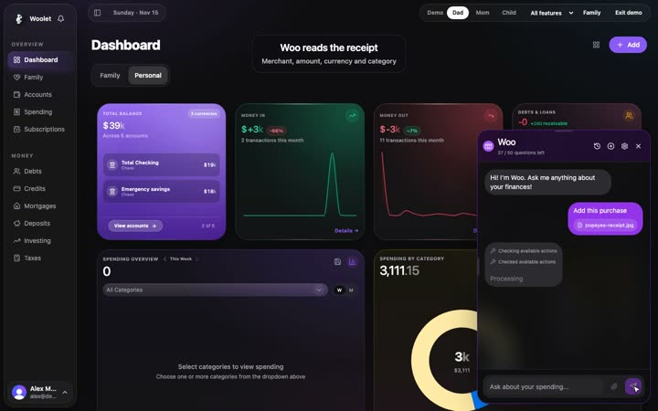
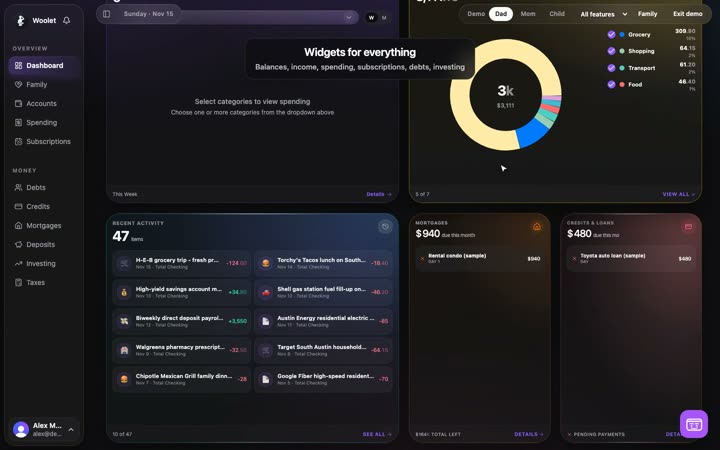
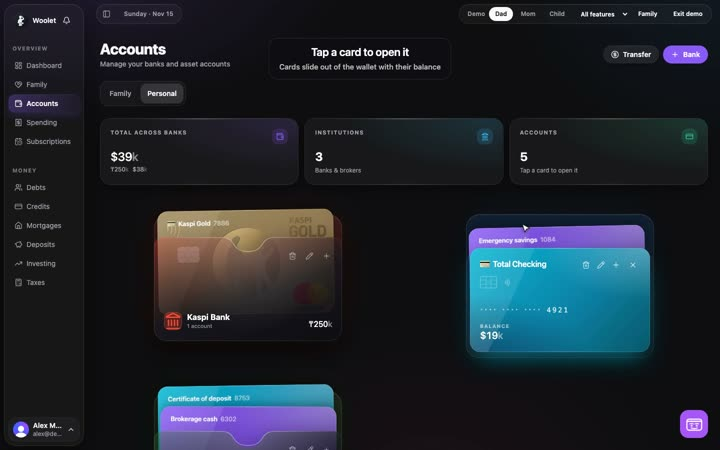
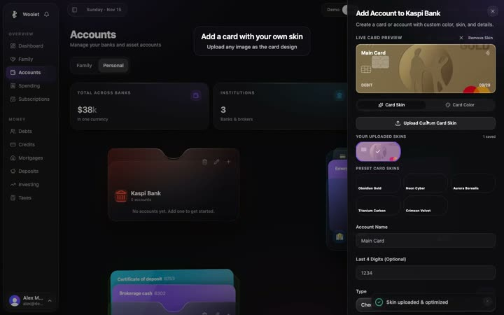
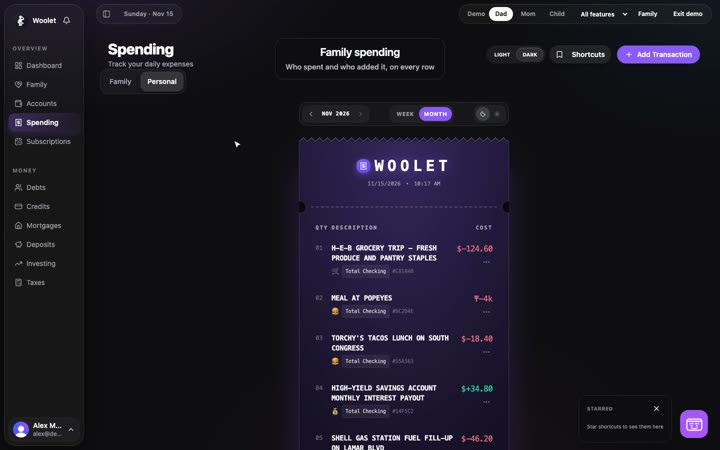
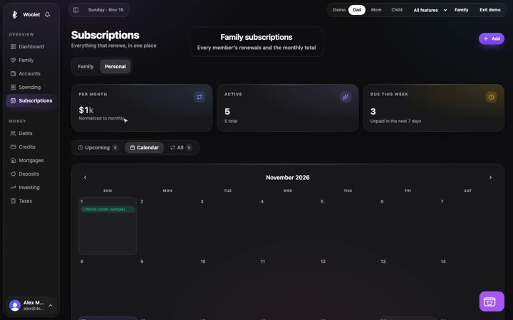
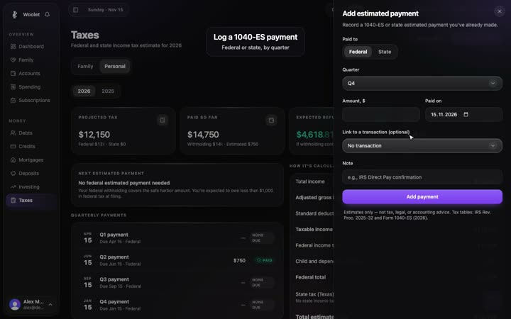
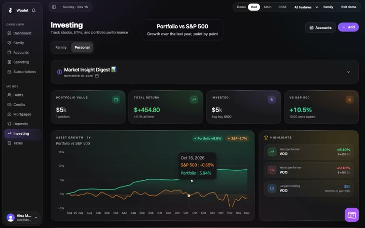

# Woolet 💰

Woolet is a personal and family finance app built with a full-stack TypeScript architecture. Families share one view of their money, with a common budget, each member's spending and shared wallets. Adults see everything shared and edit only their own records; children get their own wallets with limits. Woolet also tracks bank accounts in several currencies, transactions, debts and mortgages, subscriptions, investments and US taxes, and includes an AI assistant called Woo.

## 🚀 Features

-   **Family mode**: A household of up to 6 people, each signing in with their own Woolet account.
    -   **Family dashboard** (the default home for family members): a monthly family budget with a pace mark, who spent what, where the money went, daily spending, and recent spending showing who spent vs. who entered it.
    -   **Family and Personal views** in every finance section. Adults see each other's accounts, spending, debts, loans, subscriptions, investments and taxes, but each person edits only their own.
    -   **Shared and child wallets**, with weekly/monthly limits per wallet or category. Children see only their own wallet; parents choose whether children see balances.
    -   **Shared-purchase approvals**: purchases above a set limit become proposals that another adult approves, counters or declines.
    -   **Roles**: owner, adult (optionally a guardian of the children) and child, with email invitations.
-   **US Taxes**: Estimate of federal and state income tax for the year.
    -   2025/2026 brackets, standard and senior deductions, self-employment tax, NIIT, Additional Medicare and the Child Tax Credit.
    -   States with no income tax or a flat rate are calculated; progressive states use your own effective rate.
    -   Quarterly 1040-ES schedule with safe-harbor amounts. Log the payments you have made. Income can be filled from your transactions.
-   **Dashboard**: Drag-and-drop widgets with summaries, charts, shortcuts and spending anomalies.
-   **Banks & Accounts**: Banks with accounts inside, each holding balances in several currencies. Transfers between your own accounts and deposits.
-   **Transactions & Spending**: Income and expenses with custom categories, a universal "add" sheet, and spending charts by period and category.
-   **Split bills & money between users**: Find people by username and split transactions with them. Accept, decline or pay incoming requests in one tap, and assign incoming payments to your accounts.
-   **Debts, Credits & Mortgages**: What you owe and are owed, loans with payment schedules (including compound interest) and mortgage payments.
-   **Subscriptions**: List, upcoming and calendar views, payment reminders, and a Chrome extension that picks up subscriptions from billing pages.
-   **Investing**:
    -   Stock search, buy/sell trades and manual prices.
    -   Portfolio performance and price history.
    -   Benchmark comparison (e.g., S&P 500).
    -   Investment cash balance and market news.
-   **Woo, the AI assistant**:
    -   Chat about your money, including family questions answered with the same numbers as the family dashboard.
    -   Turns receipts, checks and bank-transfer screenshots into draft transactions you confirm.
    -   Creates transactions from text, and writes a daily digest.
-   **Multi-Currency**: Scheduled exchange rates; totals are converted to one currency without ever adding different currencies together unconverted.
-   **Notifications**: In-app and web push.
-   **Data**: Export and import your data, or delete it or your whole account.
-   **Plans**: Free, Pro and Premium via Paddle. Family mode is free.

See [docs/FEATURES.md](docs/FEATURES.md) for the full feature reference.

## 🎬 Walkthrough

Short clips recorded on the live demo (1440×900). Click a preview to play the video.

<table>
<tr>
<td width="50%" valign="top"><a href="docs/videos/01-family-dashboard.mp4"></a><br><b>Family dashboard</b><br><sub>Budget, who spent what, filters by member</sub></td>
<td width="50%" valign="top"><a href="docs/videos/03-woo-ai.mp4"></a><br><b>Woo AI</b><br><sub>Ask about the family’s money in plain words</sub></td>
</tr>
<tr>
<td width="50%" valign="top"><a href="docs/videos/09-woo-receipt.mp4"></a><br><b>Receipt → transaction</b><br><sub>Woo reads a payment screenshot and drafts the expense</sub></td>
<td width="50%" valign="top"><a href="docs/videos/02-dashboard-widgets.mp4"></a><br><b>Personal dashboard</b><br><sub>Drag-and-drop widgets</sub></td>
</tr>
<tr>
<td width="50%" valign="top"><a href="docs/videos/05-accounts.mp4"></a><br><b>Accounts</b><br><sub>Cards slide out of the wallet; Family view</sub></td>
<td width="50%" valign="top"><a href="docs/videos/05b-new-card.mp4"></a><br><b>New bank & card skin</b><br><sub>Kaspi Bank with a custom Kaspi Gold card</sub></td>
</tr>
<tr>
<td width="50%" valign="top"><a href="docs/videos/06-spending.mp4"></a><br><b>Spending</b><br><sub>The month as a receipt; family spending</sub></td>
<td width="50%" valign="top"><a href="docs/videos/07-subscriptions.mp4"></a><br><b>Subscriptions</b><br><sub>Calendar and family renewals</sub></td>
</tr>
<tr>
<td width="50%" valign="top"><a href="docs/videos/08-taxes.mp4"></a><br><b>US taxes</b><br><sub>Estimate, 1040-ES payments, family taxes</sub></td>
<td width="50%" valign="top"><a href="docs/videos/04-investing.mp4"></a><br><b>Investing</b><br><sub>AI market digest and portfolio vs S&P 500</sub></td>
</tr>
</table>

## 🎮 Hackathon demo

`/demo` opens a prefilled sample family without registration. The demo switcher lets you view the app as **Dad** (owner), **Mom** (partner) or **Child**, filter navigation to Family focus, or exit the demo.

The three demo accounts are shared by all visitors:
-   Edits persist, and each account has **50 lifetime Woo chat questions shared across all visitors**. Reopening the demo does not reset the quota.
-   Personal identity, billing, invitations, imports and cross-user payments are unavailable.
-   Debt/split, subscription, tax and investment records are provided for viewing.
-   Portfolio prices are illustrative sample data.
-   Never enter personal information in these shared accounts.

### Provisioning the demo

After applying the database migrations, provision the synthetic users and data:

```bash
cd apps/api
bun scripts/seed-demo.ts --apply
```

The API build also emits `dist/seed-demo.js` for use inside the production image, where source-only scripts are unavailable.

The script:
-   uses the existing server-side Clerk and database credentials;
-   creates only `@demo.woolet.cc` identities and prints their three non-secret user IDs;
-   is transactional and idempotent for database data, so repeat runs preserve existing demo edits and AI usage.

Then configure the API environment:
-   Set `DEMO_ENABLED=true`.
-   Set the printed `DEMO_OWNER_USER_ID`, `DEMO_PARTNER_USER_ID` and `DEMO_CHILD_USER_ID`. Keep these IDs configured even when you disable new demo sign-ins, so that existing demo sessions keep their restrictions.
-   Make sure `WEB_URL` is the public application origin.

## 🛠️ Tech Stack

### Frontend (`apps/web`)
-   **Framework**: [React](https://reactjs.org/) with [Vite](https://vitejs.dev/)
-   **Routing**: [TanStack Router](https://tanstack.com/router/latest)
-   **Data Fetching**: [TanStack Query](https://tanstack.com/query/latest) & [tRPC](https://trpc.io/)
-   **Styling**: [Tailwind CSS](https://tailwindcss.com/) & [Shadcn UI](https://ui.shadcn.com/)
-   **Charts**: [Recharts](https://recharts.org/)
-   **Authentication**: [Clerk](https://clerk.com/)

### Backend (`apps/api`)
-   **Runtime**: [Bun](https://bun.sh/)
-   **Server**: [Hono](https://hono.dev/)
-   **API**: [tRPC](https://trpc.io/)
-   **Database**: [PostgreSQL](https://www.postgresql.org/) with [Drizzle ORM](https://orm.drizzle.team/)
-   **Caching**: [Redis](https://redis.io/)
-   **Authentication**: [Clerk Backend SDK](https://clerk.com/docs/reference/backend-api)

### Shared (`packages/shared`)
-   Zod schemas and TypeScript types shared between frontend and backend.

## 📁 Project Structure

```text
├── apps/
│   ├── api/          # Bun + Hono + tRPC backend
│   └── web/          # React + Vite + Tailwind frontend
├── packages/
│   └── shared/       # Shared Zod schemas and types
├── docs/             # Technical design documents
│   ├── INVESTING_MODULE_DESIGN.md
│   └── POSTHOG_IMPLEMENTATION.md # Analytics & User Behavior Tracking
└── docker-compose.yml # Infrastructure (Postgres, Redis)
```

## 🏁 Getting Started

### Prerequisites
-   [Bun](https://bun.sh/) installed.
-   Docker (for running the database and Redis).

### Setup
1.  **Clone the repository**:
    ```bash
    git clone https://github.com/your-repo/woollet.git
    cd woollet
    ```

2.  **Install dependencies**:
    ```bash
    bun install
    ```

3.  **Spin up infrastructure**:
    ```bash
    docker-compose up -d
    ```

4.  **Configure environment variables**:
    Create `.env` files in `apps/api` and `apps/web` (refer to `.env.example` if available).

5.  **Run migrations**:
    ```bash
    bun run db:generate
    bun run db:migrate
    ```

6.  **Start development servers**:
    ```bash
    bun run dev
    ```

### Paddle Billing

Clerk remains the authentication provider; Paddle handles paid plans and checkout.

1. Create the Pro and Premium recurring prices in Paddle (the Sandbox catalog is already seeded for local development).
2. Add the client-side token, environment, price IDs, and display labels from `.env.example` to the web environment. Add the matching server price IDs, `PADDLE_API_KEY`, and notification secret to the API environment. API keys stay server-side; Paddle.js uses a client-side token.
3. In Paddle, approve the checkout domain, set a default payment link, and create a notification destination pointing to `https://your-api-domain.example/webhooks/paddle`.
4. Subscribe the destination to `transaction.completed`, `subscription.created`, `subscription.updated`, `subscription.canceled`, `subscription.trialing`, `subscription.activated`, `subscription.past_due`, `subscription.paused`, and `subscription.resumed`.
5. Use the Sandbox test card `4242 4242 4242 4242`, any future expiry, any 3-digit CVC, and any postal code. Confirm the browser returns to `/pricing?checkout=success`, the webhook log shows `200`, and the user row changes to `pro` or `premium`.

The API verifies Paddle signatures against the raw request body, tolerates out-of-order webhook delivery, and updates `users.subscription_tier` only for the configured Paddle price IDs. The account panel uses Paddle's customer portal for active subscribers; portal URLs are minted server-side from the authenticated user's stored Paddle customer ID. Access is provisioned by the webhook, not by the browser redirect. Sandbox and Live have separate products, prices, client tokens, API keys, and notification destinations.

## 🤝 Contributing

Please see [CONTRIBUTING.md](CONTRIBUTING.md) for development guidelines and coding standards.

## 📄 License

This project is licensed under the MIT License.
